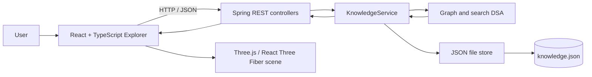

# NEURAL NEBULA

> **An interactive 3D knowledge graph and second brain powered by data structures and algorithms.**

NEURAL NEBULA turns notes into nodes in a navigable 3D galaxy. Relationships between notes form an undirected knowledge graph, so you can explore how ideas connect, trace paths, and inspect graph structure. The application is also a working demonstration of custom Java DSA implementations behind a real REST API.

> **Project status:** local development project. No hosted deployment is configured.

[Overview](#overview) · [Features](#features) · [DSA](#data-structures--algorithms) · [Architecture](#architecture) · [Run locally](#run-locally) · [API](#api-reference) · [Tests](#testing)

## Overview

Notes are easy to create and hard to navigate once they accumulate in separate files. NEURAL NEBULA models each note as a graph vertex and each ordinary relationship as an undirected edge. The Explorer renders that graph in 3D, while search, traversal, similarity, and learning-order tools help users move through it.

Unlike a conventional notes list, the project makes relationships and graph operations part of the interface. It combines note management and persistent storage with algorithms that can be inspected through their results and operation counts.

## Features

- **3D knowledge galaxy** — browse notes as selectable nodes, orbit and zoom the scene, focus a note, and inspect its details.
- **Four note types** — organize notes as Concept, Resource, Question, or Summary.
- **Knowledge links** — create and remove typed relationships. Similarity suggestions are ranked for review; suggestions alone do not create a link. High-confidence matches can also create or refresh automatic relationships when a note is created or edited.
- **Explore Connections** — focus a selected note and its direct neighbors while dimming unrelated graph elements. Selecting another node updates the explored neighborhood.
- **Search and discovery** — AND keyword search, Trie-based prefix suggestions, typo corrections, related-note suggestions, and a command palette.
- **Graph analysis** — find an unweighted shortest path, run DFS, inspect connected components and topic communities, and rank important notes with Top-K.
- **Learning order** — manage directed prerequisite dependencies separately from ordinary graph links and calculate a prerequisite-first order.
- **Undo and redo** — reverse successful note, relationship, and prerequisite mutations for the current backend session.
- **Persistent graph** — notes, relationships, and prerequisites are stored in a versioned JSON file. Derived indexes and graph structures are rebuilt in memory.

## Data Structures & Algorithms

The backend's DSA implementations are in `backend/src/main/java/com/neuralnebula/dsa/`. The graph operations below are application code, not delegated to a graph library.

### Data structures

| Structure | Implementation | Use in NEURAL NEBULA |
| --- | --- | --- |
| Undirected adjacency-list graph | Custom `NoteGraph`; each vertex maps to its neighboring IDs | Stores ordinary note relationships and supplies neighbors to graph algorithms. Expected O(1) average vertex/edge lookup and neighbor access with the backing hash collections. |
| Note ID lookup | `NoteLookup` wraps Java `HashMap<String, Note>` | Expected O(1) average note lookup, insertion, replacement, and removal. The lookup behavior is project code; the hash table itself is Java's standard library implementation. |
| Inverted keyword index | Custom indexing logic in `KeywordIndex`, backed by `HashMap` and `HashSet` | Maps normalized terms to note IDs and note IDs to their terms for search and candidate generation. It is not a custom hash table. |
| Trie | Custom character Trie in `AutocompleteTrie` | Finds lexicographically ordered autocomplete terms by prefix. Navigation costs O(P) for prefix length P; collecting matches depends on the Trie nodes visited and results returned. |
| Disjoint-set forest | Custom `UnionFind` with path compression and union by rank | Groups connected graph vertices. A sequence of operations is amortized O(α(V)) per operation, where α is the inverse Ackermann function; maps are standard-library backing storage. |
| Max-heap | Custom `NoteMaxHeap`, backed by Java `ArrayList` | Ranks notes by importance with deterministic ID tie-breaking. Build is O(V), peek O(1), insert and removal O(log V). |
| Queues and stacks | Java `ArrayDeque` | FIFO queue for BFS and LIFO stack for DFS. These are standard-library collections, not custom implementations. |
| Other collections | Java `ArrayList`, `HashMap`, `HashSet`, `TreeMap`, `TreeSet`, and immutable `List`/`Set` snapshots | Store intermediate results, indexes, ordered Trie children, and deterministic output. They are Java Collections Framework types. |

### Algorithms

| Algorithm | How it is used | Complexity reflected by the implementation |
| --- | --- | --- |
| Breadth-first search (BFS) | Finds an unweighted shortest path between two notes. Neighbors are sorted for deterministic traversal. | O(V + E log(Δ + 1)) worst case, where Δ is maximum degree, due to sorting each visited adjacency list. |
| Depth-first search (DFS) | Traverses the reachable graph from a selected note; returns order and operation counts. | O(V + E log(Δ + 1)) worst case for the same deterministic neighbor sorting. |
| Connected components | Unions every edge's endpoints, then groups vertices by representative. | O((V + E) α(V)) amortized, excluding output ordering. |
| Weighted label propagation | Groups graph nodes using Jaccard-weighted links, a minimum edge threshold, and up to 20 deterministic sweeps. | Up to 20 sweeps over vertices and retained neighbor links; ordered score maps add logarithmic work per neighbor. This is a heuristic, not a globally optimal partition. |
| Kahn topological sort | Produces a prerequisite-first learning order and reports nodes blocked by cycles. The smallest ready ID is found by scanning remaining nodes. | O(V² + E), as implemented. |
| Jaccard similarity | Scores keyword overlap for related-note suggestions, community edge weights, and weighted title/content/tag comparison. | O(A + B) expected for two term sets of sizes A and B using hash collections. |
| Levenshtein distance | Suggests corrections for misspelled single-token searches; uses rolling rows and a cutoff-banded variant. | O(mn) worst-case time and O(min(m,n)) space for strings of lengths m and n; the cutoff version can inspect a narrower band. |
| Keyword normalization | Lowercases and extracts unique Unicode letter/digit tokens, excluding a small stop-word set. | Linear in input text length, plus ordered-set insertion costs. |

`NoteMaxHeap`, `NoteGraph`, `AutocompleteTrie`, `UnionFind`, and the graph/search algorithms are custom project implementations. `HashMap`, `HashSet`, `ArrayList`, `ArrayDeque`, and tree-based ordered collections are standard Java collections used as backing or working structures. The learning-order implementation does **not** use a `PriorityQueue`.

## Technology Stack

| Area | Technology | Role |
| --- | --- | --- |
| Backend | Java 21, Spring Boot 4, Maven | REST endpoints, validation, domain services, DSA operations, and persistence orchestration. |
| Frontend | React 19, TypeScript, Vite 8 | Explorer interface, API client, development server, and production bundle. |
| 3D scene | Three.js, React Three Fiber, Drei | Galaxy rendering, node interaction, labels, and camera controls. |
| Storage | Versioned JSON file | Canonical notes, ordinary relationships, and prerequisites. No database is configured. |
| Tests | JUnit / Spring Boot test dependencies | Backend unit, persistence, and API integration coverage. |

## Architecture

The React interface requests graph and analysis data from Spring Boot. Controllers validate requests and call `KnowledgeService`; it coordinates domain records, DSA state, and JSON persistence. Each successful mutation is validated against a rebuilt candidate state and written before the new in-memory state is published. Graph adjacency lists, note lookup, keyword indexes, and autocomplete vocabulary are derived from the persisted records at startup and after mutations.



### Project structure

```text
.
├── backend/
│   ├── data/knowledge.json             # Local canonical sample graph
│   ├── src/main/java/com/neuralnebula/
│   │   ├── api/                        # REST controllers, DTOs, error handling
│   │   ├── domain/                     # Note and relationship records/enums
│   │   ├── dsa/                        # Graph, indexes, heap, Trie, algorithms
│   │   ├── persistence/                # Versioned JSON file store
│   │   └── service/                    # Knowledge coordination and sample data
│   ├── src/main/resources/             # Spring configuration
│   └── src/test/java/                  # Backend tests
├── frontend/
│   ├── public/                         # Favicon and public assets
│   └── src/
│       ├── api/                        # Backend API client
│       ├── components/                 # Landing page, canvas, HUD, palette
│       └── galaxy/                     # Deterministic visual layout utilities
```

## Run Locally

### Prerequisites

- JDK 21
- Maven installed and available as `mvn` (no Maven wrapper is included)
- Node.js `^20.19.0` or `>=22.12.0` and npm (Vite 8 engine requirement)

### 1. Start the backend

From the repository root, in PowerShell:

```powershell
cd backend
mvn spring-boot:run
```

The API listens on `http://localhost:8080` by default. When launched from `backend/`, the default storage path `data/knowledge.json` resolves to `backend/data/knowledge.json`.

Configuration:

| Setting | Default | Purpose |
| --- | --- | --- |
| `server.port` | `8080` | Spring Boot HTTP port. |
| `NEURAL_NEBULA_STORAGE_PATH` | `data/knowledge.json` | Selects the canonical JSON file. |
| `NEURAL_NEBULA_SEED_SAMPLE_DATA` | `false` | Seeds sample data only when the configured file does not exist. |

For example, set a different local data file before starting the backend:

```powershell
$env:NEURAL_NEBULA_STORAGE_PATH = 'data/my-knowledge.json'
mvn spring-boot:run
```

The checked-in `backend/data/knowledge.json` contains sample graph data and can be changed by create, update, and delete operations when used as the configured store. Back it up before experimenting or point `NEURAL_NEBULA_STORAGE_PATH` at a separate file. Seeding is disabled by default and does not overwrite an existing file.

### 2. Start the frontend

Open a second terminal from the repository root:

```powershell
cd frontend
npm install
npm run dev
```

Open the local URL printed by Vite (normally `http://localhost:5173`). The development server proxies `/api` requests to `http://localhost:8080`, so the default setup does not need a separate CORS configuration.

Optional frontend configuration: copy `frontend/.env.example` to an untracked `frontend/.env.local`. `VITE_DEV_API_TARGET` changes the Vite proxy target; `VITE_API_BASE_URL` sets a direct API base URL instead of using the proxy. Do not commit machine-specific `.env.local` values.

## API Reference

All routes are served from the backend at `http://localhost:8080`. Request validation and errors are handled by Spring; error bodies use `status`, `code`, `message`, and `path` fields.

| Method | Endpoint | Purpose |
| --- | --- | --- |
| `GET` | `/api/graph` | Return graph nodes and persisted ordinary relationship edges. |
| `GET` | `/api/notes` | List notes in deterministic ID order. |
| `POST` | `/api/notes` | Create a note; server generates its ID and timestamps. |
| `GET` | `/api/notes/{id}` | Retrieve one note. |
| `PUT` | `/api/notes/{id}` | Update title, content, tags, type, and importance. |
| `DELETE` | `/api/notes/{id}` | Delete a note and its incident relationships and prerequisites. |
| `GET` | `/api/search?q=...` | AND search over normalized title, content, and tag terms. |
| `GET` | `/api/search/suggestions?q=...&limit=10` | Prefix autocomplete and single-token typo corrections. |
| `POST` | `/api/relationships` | Create an ordinary relationship. |
| `DELETE` | `/api/relationships/{id}` | Remove an ordinary relationship. |
| `GET` | `/api/relationships/suggestions?noteId=...&threshold=0.1` | Rank related-note suggestions without creating edges. |
| `GET` | `/api/algorithms/path?from=...&to=...` | Find a shortest unweighted path with BFS. |
| `GET` | `/api/algorithms/dfs?start=...` | Run DFS from a note. |
| `GET` | `/api/algorithms/components` | Return connected components. |
| `GET` | `/api/algorithms/communities` | Return weighted label-propagation communities. |
| `GET` | `/api/algorithms/top-k?limit=10` | Rank notes by importance using the custom max-heap. |
| `GET` | `/api/algorithms/learning-order` | Calculate prerequisite-first order and report cycle-blocked IDs. |
| `GET` | `/api/prerequisites` | List directed prerequisite dependencies. |
| `POST` | `/api/prerequisites` | Add a directed prerequisite dependency. |
| `DELETE` | `/api/prerequisites/{prerequisiteNoteId}/{dependentNoteId}` | Remove a prerequisite dependency. |
| `GET` | `/api/history` | Read current-session undo/redo availability. |
| `POST` | `/api/history/undo` | Persist and apply the latest undo operation. |
| `POST` | `/api/history/redo` | Persist and reapply the latest undone operation. |

Example create-note request:

```json
{
  "title": "Graph Theory",
  "content": "Graphs model relationships between entities.",
  "tags": ["graphs", "algorithms"],
  "type": "CONCEPT",
  "importance": 90
}
```

Example relationship request:

```json
{
  "sourceNoteId": "note-id-a",
  "targetNoteId": "note-id-b",
  "type": "RELATED"
}
```

Example prerequisite request:

```json
{
  "prerequisiteNoteId": "note-id-a",
  "dependentNoteId": "note-id-b"
}
```

## Visual Showcase

There is no tracked screenshot of the running application yet. Add verified UI captures here when available; `frontend/src/assets/hero.png` is an icon asset, not a product screenshot. The Mermaid diagram above provides the current architecture view.

## Testing

Run backend tests from `backend/`:

```powershell
mvn test
mvn clean verify
```

The backend suite includes domain and custom DSA tests, JSON persistence tests, service-level mutation/history/automatic-link tests, and REST integration tests for note, graph, algorithm, and prerequisite endpoints.

Run frontend checks from `frontend/`:

```powershell
npm run lint
npm run build
```

`npm run build` runs the TypeScript project build before producing the Vite production bundle.

## Notes and Limitations

- Undo/redo history is held in memory and is cleared when the backend restarts; the latest graph data remains in JSON.
- Ordinary relationships are undirected. Prerequisite dependencies are a separate directed relation and do not affect graph connectivity.
- Community detection is a deterministic weighted heuristic, not a semantic guarantee.
- This repository does not configure a production deployment, database, or authentication system.
- The frontend production build currently reports a large Three.js scene chunk.

## Future Improvements

These are possible extensions, not current features:

- Add verified screenshots or a short recording of the Explorer and its analysis tools.
- Add browser-based end-to-end tests for the 3D interactions and responsive layouts.
- Evaluate a database-backed persistence adapter if multi-user or larger-scale deployment becomes a goal.

## License

No license file is currently included. Contact the project owner before redistributing or reusing the project.
